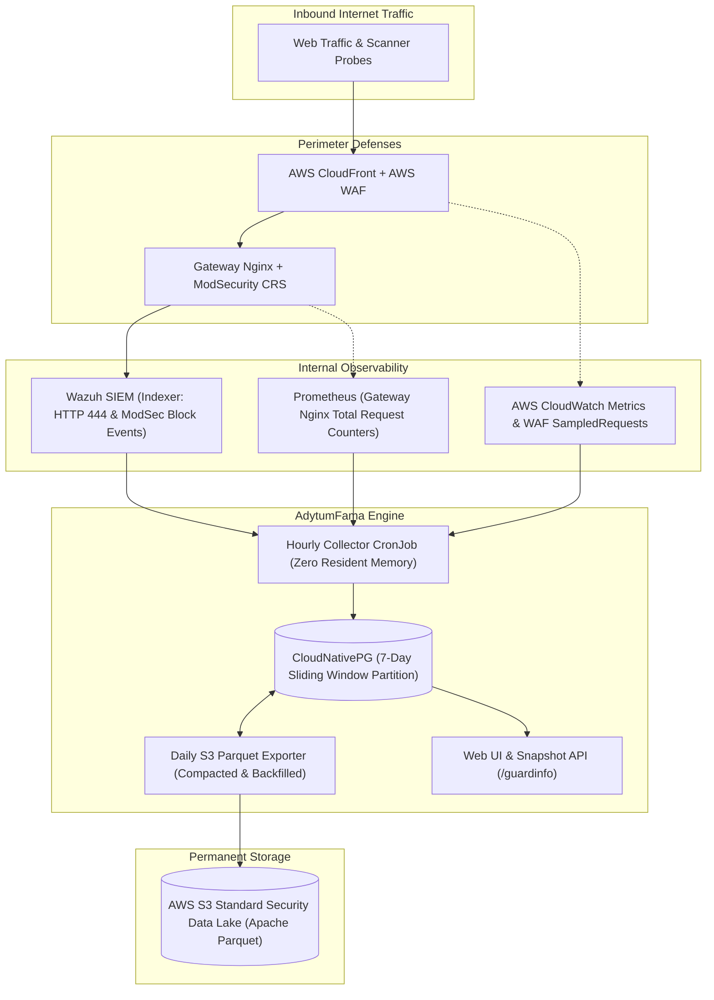

# AdytumFama

> **Perimeter Security Telemetry Collector, S3 Security Data Lake Archiver, and Public Threat Dashboard**

[](LICENSE)

**AdytumFama** (*Adytum* = sanctuary / behind the defense perimeter, *Fama* = report / observation bulletin) is a lightweight, zero-trust telemetry pipeline and observability platform designed to observe, deduplicate, and archive perimeter traffic from edge gateways (CloudFront / WAF / ModSecurity / Nginx).

---

## Architecture Overview



### Core Design Principles
1. **Low-Cost 1-Hour Batch (CronJob Architecture)**:
   - Eliminates expensive WebSocket/polling overhead.
   - Resident memory consumption: **0 MiB** (Pod terminates after execution in seconds).
   - Minimal AWS API footprint (~$0.05 / month for CloudWatch metrics).
2. **Strict Traffic Deduplication**:
   - Accurately computes true inbound traffic by mathematically isolating CloudFront origin passes from direct-IP bypass scans (`HTTP 444`).
3. **Two-Tier Storage Architecture**:
   - **Hot Tier (PostgreSQL 7 Days)**: Fast serving for `LAST 24 HOURS` / `LAST 7 DAYS` views on `/guardinfo`.
   - **Cold Tier (AWS S3 Standard Parquet)**: Daily compacted Zstd Parquet files. Avoids 128KB minimum charge traps and transition fees by using single-tier S3 Standard.
4. **AWS IAM Roles Anywhere (Zero Static Credentials)**:
   - Uses in-cluster X.509 client certificates (signed by `step-ca`) to request temporary AWS STS sessions with strict Common Name (CN) binding.

---

## Directory Structure

```text
.
├── cmd/
│   ├── collector/       # Hourly telemetry collection CronJob
│   └── exporter/        # Daily S3 Parquet export & 7-day backfill job
├── pkg/
│   ├── awsauth/         # AWS IAM Roles Anywhere authentication helper
│   ├── datalake/        # Apache Parquet compression and S3 upload
│   ├── dedupe/          # Multi-layer traffic deduplication formulas
│   ├── geoip/           # MaxMind GeoLite2 MMDB memory-mapped lookup
│   ├── rdns/            # Reverse DNS resolution and scanner tagger
│   └── sources/         # OpenSearch, Prometheus, CloudWatch, and WAF clients
├── web/                 # Next.js 14+ responsive UI (/guardinfo) & API
├── charts/              # Helm chart (adytum-fama)
└── .github/workflows/   # CI/CD pipelines
```

---

## Attribution & Licenses

- This product includes GeoLite2 data created by MaxMind, available from [https://www.maxmind.com](https://www.maxmind.com).

---

## License

AdytumFama is open-sourced under the [Apache 2.0 License](LICENSE).
